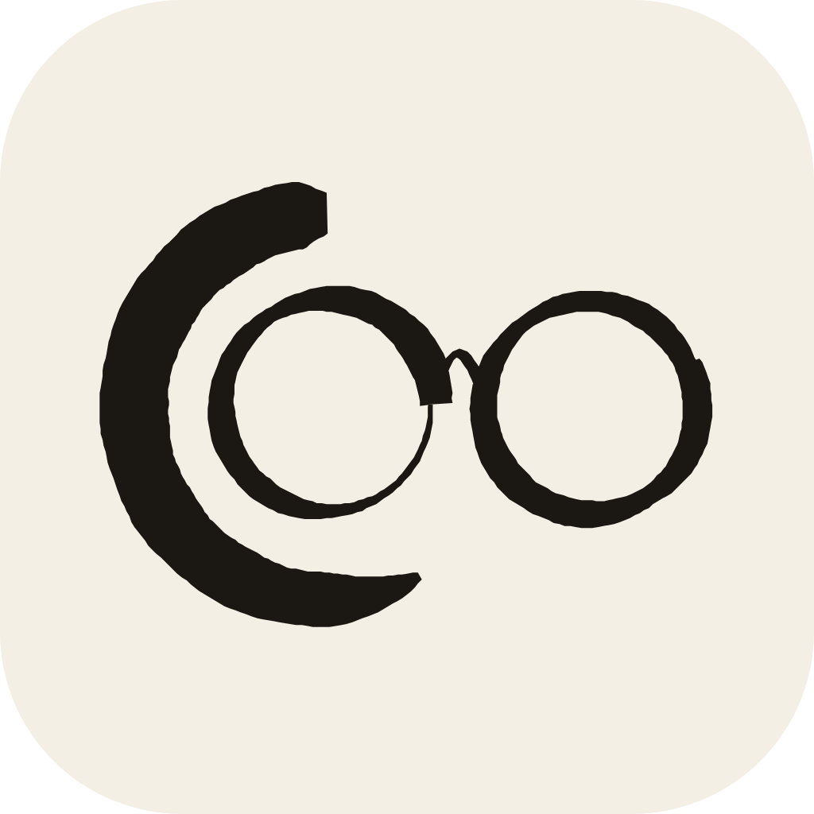

<p align="center"></p>

# Cookrew

A desktop app for running a crew of AI coding agents on your own machine. One view
zooms from your devices down to a single agent's terminal, your phone reaches the
same crew, and every agent gets a `cookrew` CLI to talk to the others.

[cookrew.dev](https://cookrew.dev)

## Download

**[Get the latest release](https://github.com/cookrew/cookrew-app/releases/latest)**

| Platform | File |
| --- | --- |
| macOS, Apple Silicon | `Cookrew-<version>-arm64.dmg` |
| Windows (preview) | `Cookrew-<version>-windows-preview-x64.exe` |

There is no Intel Mac or Linux release. On Windows agents end when the app closes.

> **Not notarized yet.** Releases up to and including 0.4.0 are unsigned, so macOS
> stops them on first launch. Until a release says it is notarized, drag Cookrew to
> Applications and clear the quarantine flag before opening it:
>
> ```bash
> xattr -dr com.apple.quarantine /Applications/Cookrew.app
> ```

## Requirements

- macOS 11 or later on Apple Silicon.
- [Node.js](https://nodejs.org) on your PATH. The `cookrew` command runs on it.
- At least one agent CLI: Claude Code, Codex, OpenCode or Pi. A plain shell works too.

Optional, and each one turns something on:

- **[herdr](https://herdr.dev)** or **tmux**: agents keep running when Cookrew closes.
  Install herdr with `curl -fsSL https://herdr.dev/install.sh | sh`. Without either,
  closing the app ends the agents.
- **Google Chrome, Chromium or Microsoft Edge**: agents and the phone can drive
  browser cards.
- **[Tailscale](https://tailscale.com)**: the phone reaches this Mac away from home
  without the cookrew.dev relay.

Cookrew finds herdr and tmux on its own PATH, and macOS gives an app opened from
Finder or the Dock a minimal one that includes neither `~/.local/bin` nor Homebrew.
To keep agents across restarts today, start it from a terminal:

```bash
/Applications/Cookrew.app/Contents/MacOS/Cookrew
```

## The zoom view

The whole app is one zoom with named stops on the bar:

**devices → workspaces → agents | artifacts**

Click a device, a workspace or a card to go in. Click the background, press Esc or
use the back button to come out. An agent opens from the crew into its card, then
into a full view. A switch on the bar flips a workspace between its agents and its
artifacts. On a touch screen, pinch works too.

Press `/` to search everything on the board. The prompt box at the foot of the window
talks to the agent you have open or named with `@agent`. With nobody targeted, it
starts a new agent and names it from what you wrote. Hold ⌘ to dictate; speech is
recognized on your Mac.

## Agents

An agent is a real terminal running a harness: Claude Code, Codex, OpenCode, Pi or a
plain shell. Its face shows whether it is working, done or waiting on you, and a chime
rings for those last two. The full view shows the same agent as a readable chat or as
the live terminal, with its checkpoints alongside.

One agent in a workspace can be the orch, which leads the crew and may restructure it.

The Claude Code preset starts with `--permission-mode bypassPermissions`, and Cookrew
is not sandboxed: agents can do what your user account can do.

## Artifacts

What agents produce and use, on the other side of the same zoom:

- **Browsers**: live pages an agent can read and drive, with tabs.
- **Notes**: markdown, stored as real `.md` files under `~/.cookrew/workspaces`.
- **Screens and devices**: a browser card can also show a Mac display or window
  (`screen://main`, `window://App`), an Android phone (`adb://SERIAL`), a virtual
  iPhone (`vphone://VM`) or a camera (`cam://0`). The Mac cards need Screen Recording
  permission. Letting agents click and type on the Mac also needs Accessibility and
  `COOKREW_COMPUTER_INPUT=1`.

## Phone

`cookrew mobile` prints a URL and a QR code. Open it on the phone: no app to install.
You get the same zoom, terminals, the prompt box and dictation. The phone connects over
your Wi-Fi, over Tailscale, or from anywhere through the cookrew.dev relay.
`cookrew mobile --rotate` revokes the pairing token.

## The cookrew CLI

Cookrew puts `cookrew` (or `crew`, for short) on the PATH of every terminal it runs.
It is the whole agent API, with no SDK to install.

```bash
cookrew list                               # who and what is wired to you
cookrew ask "Atlas" "why is CI red?"       # send a prompt, wait for the reply
cookrew ask "Atlas" "run the suite" --no-wait
cookrew status                             # thinking, waiting, replied or idle
cookrew check "Atlas"                      # read an agent's terminal
cookrew recruit --prompt "port the parser" # start a teammate, named from the prompt
cookrew note create "Release checklist"
cookrew browser create https://example.com "Docs"
cookrew browser snapshot "Docs"
cookrew browser create screen://main "My screen"
cookrew team save "Reviewers"              # snapshot the crew as a reusable team
```

Run `cookrew help` for the rest. Reaching a card by name wires you to it. Verbs that
restructure the crew, such as `connect`, `dismiss` and `workspace switch`, are for the
orch.

## License

MIT

## Development

```bash
npm install        # rebuilds node-pty for Electron, builds cr-listen
npm run dev        # the app, with hot reload
npm test
npm run typecheck
npm run dist:mac   # dmg and zip in release/
```

If `node-pty` fails with `'functional' file not found`, your Command Line Tools are
missing their libc++ headers:

```bash
export CXX="c++ -isystem $(xcrun --show-sdk-path)/usr/include/c++/v1"
npx electron-rebuild -f -w node-pty
```

Releases come from `.github/workflows/release.yml` on a `v*` tag. It signs and notarizes
the Mac build when the secrets are set, and says so in the job summary when they are
not. To check a build the way macOS will, without launching it:

```bash
scripts/verify-mac-release.sh release/Cookrew-<version>-arm64.dmg
```
